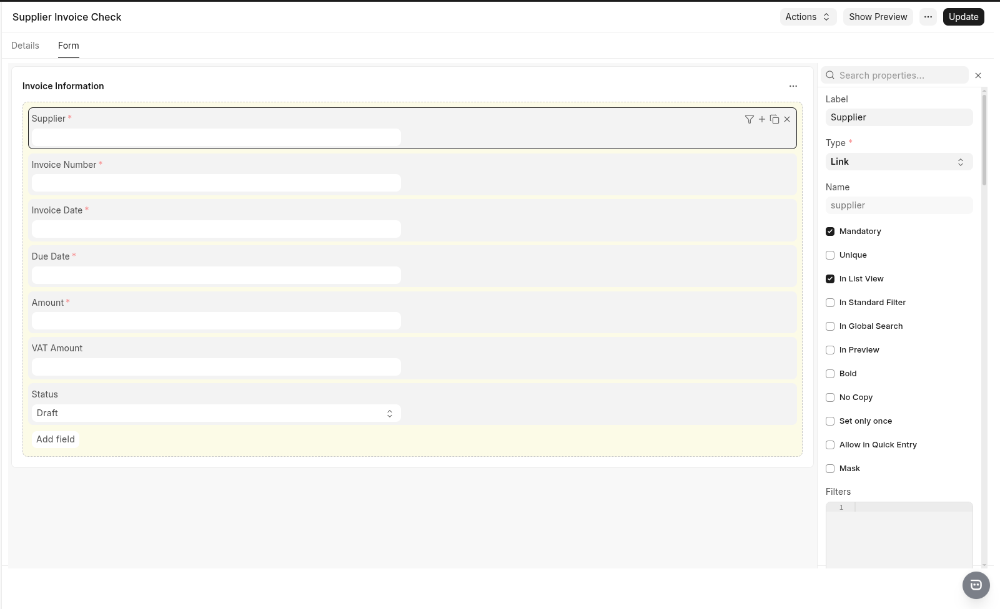
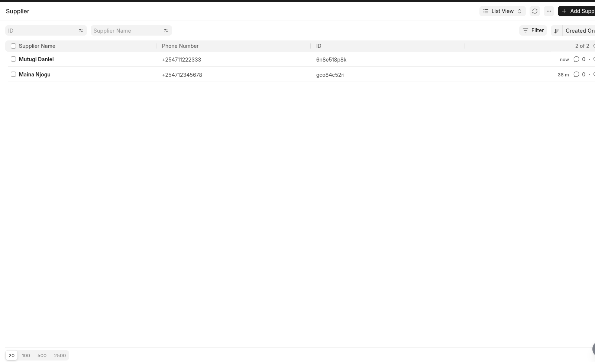
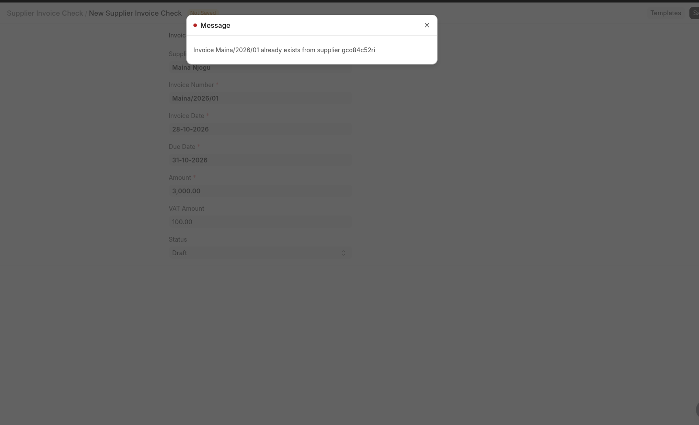
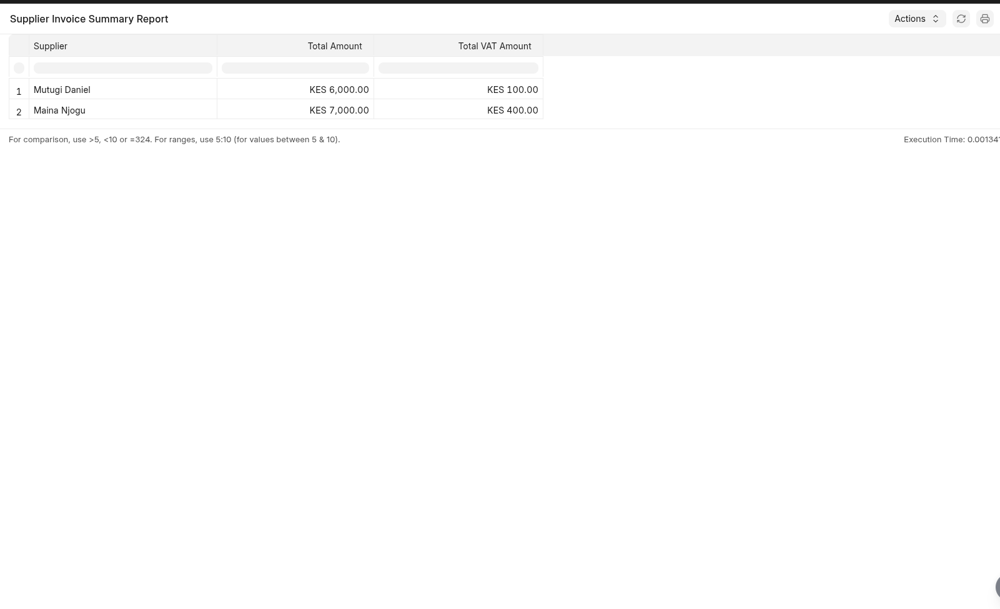

### Jukaki App

# Supplier Invoice Check

A custom application built with the [Frappe Framework](https://frappeframework.com/) to record, validate, and summarize supplier invoices. The project shows practical ERP development concepts, including DocType design, server-side validation, database queries, and reporting.

## Overview

Supplier Invoice Check helps a business maintain supplier invoice records and review invoice totals by supplier. 
This project was developed as a practical exercise to demonstrate my understanding of Frappe application development and business workflow automation.

## Features

- **Supplier management:** Link invoices to supplier records.
- **Invoice recording:** Capture invoice numbers, invoice dates, due dates, amounts, and VAT amounts.
- **Server-side validation:** Prevent invalid invoice records from being saved.
- **Duplicate invoice prevention:** Reject duplicate invoice numbers for the same supplier.
- **Date validation:** Ensure the due date is not earlier than the invoice date.
- **Amount validation:** Ensure the invoice amount is greater than zero.
- **Invoice status tracking:** Categorize invoices as Draft, Verified, or Rejected.
- **Supplier Invoice Summary report:** Aggregate invoice amounts and VAT amounts by supplier.
- **Readable supplier names:** Display supplier names in the interface and report rather than relying on internal record IDs.

## Techn Stack

- **Framework:** Frappe Framework
- **Language:** Python
- **Database:** MariaDB, as configured by the Frappe environment
- **Frontend:** Frappe Desk interface
- **Reporting:** Frappe Script Report and SQL aggregation
- **Version control:** Git and GitHub

## Application Structure

The application includes the following main components:

| Component | Purpose |
|---|---|
| Supplier DocType | Stores supplier details such as name, email, and phone number. |
| Supplier Invoice Check DocType | Stores invoice information and its current status. |
| Validation logic | Checks invoice amounts, dates, and duplicate supplier invoice combinations. |
| Supplier Invoice Summary | Summarizes invoice amounts and VAT amounts by supplier. |

## Invoice Fields

The Supplier Invoice Check DocType includes the following fields:

| Field | Description |
|---|---|
| Supplier | Supplier associated with the invoice |
| Invoice Number | Supplier's invoice reference |
| Invoice Date | Date the invoice was issued |
| Due Date | Date payment is due |
| Amount | Invoice amount before VAT, according to the configured business definition |
| VAT Amount | VAT amount recorded for the invoice |
| Status | Draft, Verified, or Rejected |

## Validation Rules

The application implements the following validation rules:

1. **Positive invoice amount:** The invoice amount must be greater than zero.
2. **Valid invoice dates:** The due date cannot be earlier than the invoice date.
3. **Duplicate prevention:** The same invoice number cannot be recorded more than once for the same supplier.
4. **Supplier association:** Invoice records are linked to supplier records through a Frappe Link field.

These validations help maintain data consistency and reduce common invoice-entry errors.

## Supplier Invoice Summary Report

The Supplier Invoice Summary report groups invoice records by supplier and calculates:

- Total invoice amount per supplier.
- Total VAT amount per supplier.

The report uses database aggregation to calculate the totals, making it easier to review supplier-related invoice values in one place.

The report currently summarizes all invoice statuses unless its query is configured to filter specific statuses.

## Snapshots

### 1. Supplier Invoice Check Form

This screenshot below shows the invoice form and its fields.



### 2. Supplier Records

This screenshot below shows the supplier records available for linking to invoices.



### 3. Validation in Action

The snapshot below an example of a validation message when a duplicate invoice for the same supplier is entered.



The snapshot below an example of a validation message when a premature due date is entered.


### 4. Supplier Invoice Summary Report

The screenshot below shows a report displaying supplier names and the aggregated invoice and VAT amounts.



## Installation and Setup

The application is designed to run inside a Frappe Bench environment.

### Prerequisites

- Python and Node.js versions compatible with your installed Frappe version.
- Git.
- A working Frappe Bench installation.
- A MariaDB database configured for Frappe.

### Install the Application

From your Frappe Bench directory, run:

```bash
bench get-app https://github.com/Alekiie/jukaki-frappe-erpnext.git
```

Install the application on your Frappe site:

```bash
bench --site jukaki.local install-app jukaki_app
```

Apply migrations and clear the cache:

```bash
bench --site jukaki.local migrate
bench --site jukaki.local clear-cache
```

Start the development environment if it is not already running:

```bash
bench start
```

**Note:** This installation process was conducted on my Manjaro Linux machine.I outlined the steps that I followed to bring the project up and running on my personal computer.Steps for other operating systems may differ (I will add them as soon as possible)

## Testing the Application

The following checks can be used to verify the core functionality:

- Create a supplier and confirm that it appears in the Supplier link field.
- Create an invoice with a positive amount and valid dates.
- Attempt to save an invoice with an amount of zero or less.
- Attempt to save an invoice whose due date precedes its invoice date.
- Attempt to create a duplicate invoice number for the same supplier.
- Create invoices for multiple suppliers and verify the totals in the summary report.
- Confirm that supplier names are displayed clearly in the form and report.

## Future Improvements

Potential enhancements include:

- Filtering the summary report by invoice date and status.
- Adding supplier-level invoice detail views.
- Introducing payment tracking and outstanding-balance calculations.
- Adding automated tests for validation rules.
- Improving reporting and export options.

These are potential extensions and are not claimed as implemented features.


## Author

**Alexander Maina**

GitHub: [Alekiie](https://github.com/Alekiie)

Portfolio: [alexander-maina.vercel.app](https://alexander-maina.vercel.app)

## License

This project is available for learning and demonstration purposes. A formal license should be added to the repository if you intend to permit reuse or redistribution.


### Contributing

This app uses `pre-commit` for code formatting and linting. Please [install pre-commit](https://pre-commit.com/#installation) and enable it for this repository:

```bash
cd apps/jukaki_app
pre-commit install
```

Pre-commit is configured to use the following tools for checking and formatting your code:

- ruff
- eslint
- prettier
- pyupgrade

